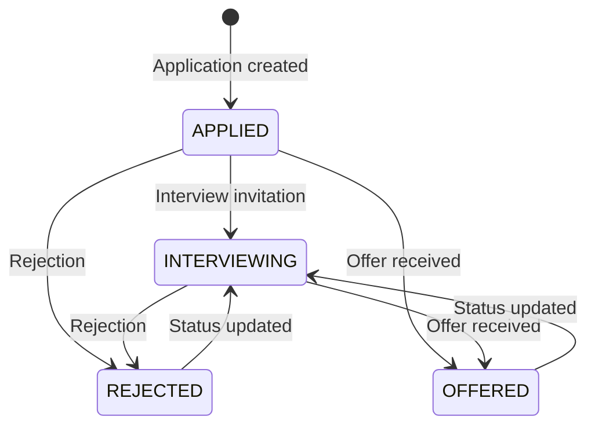
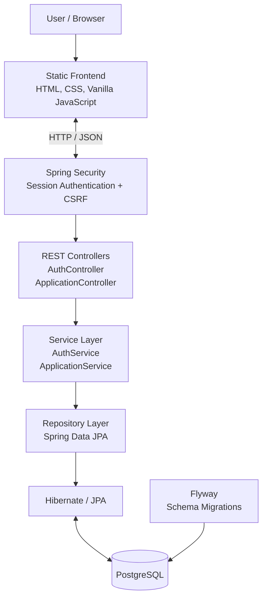
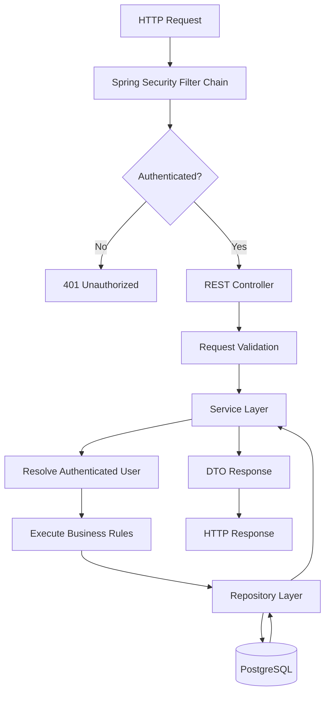
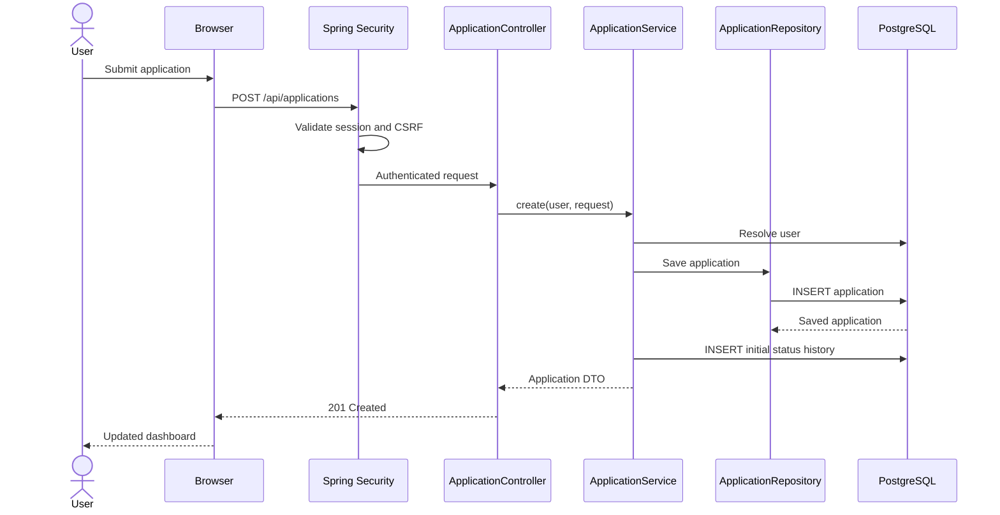
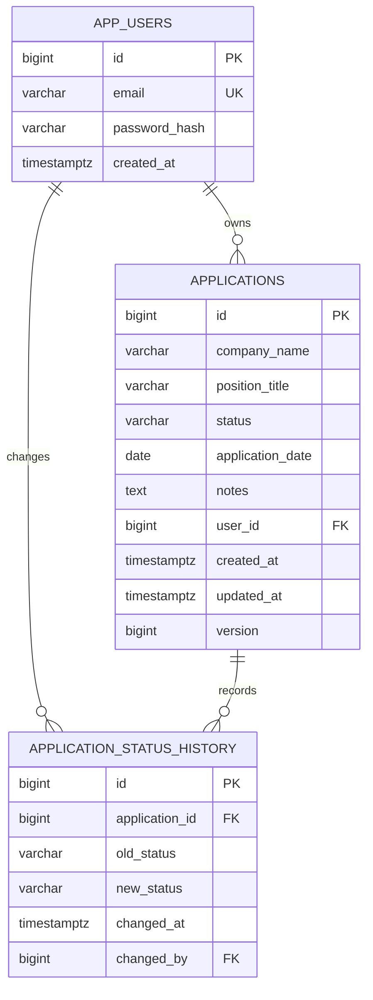
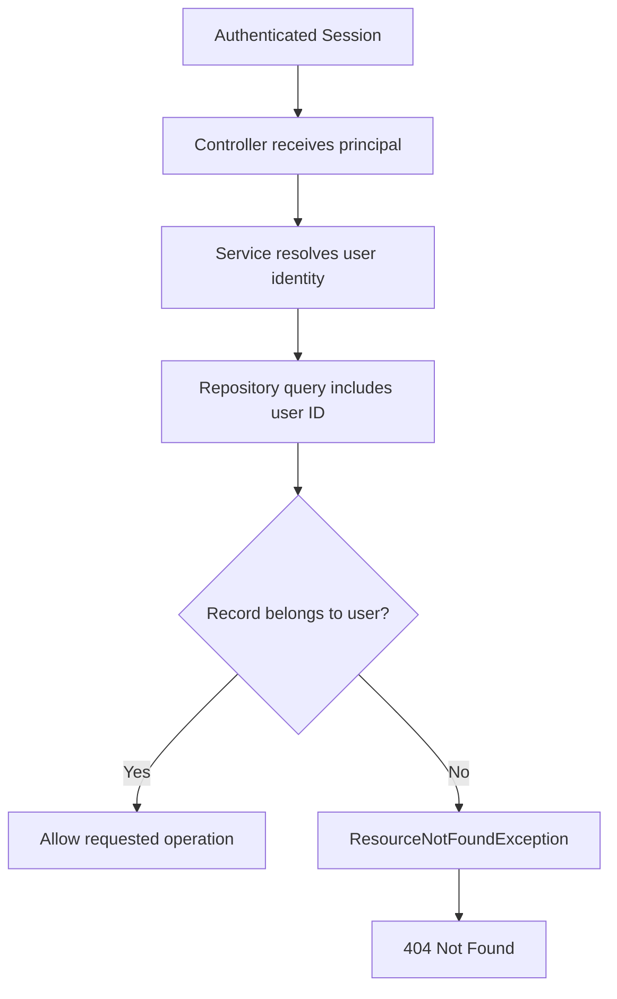
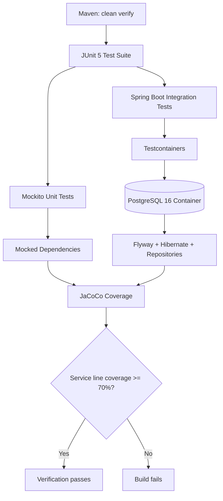
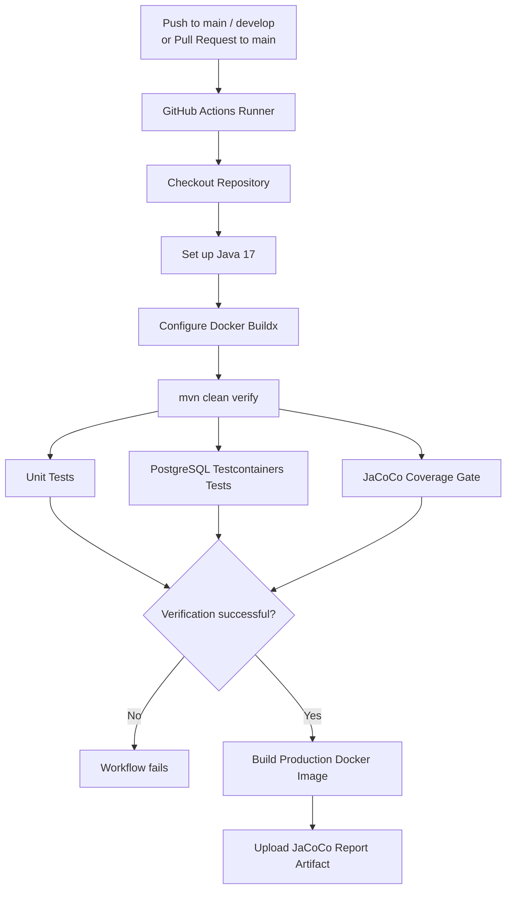
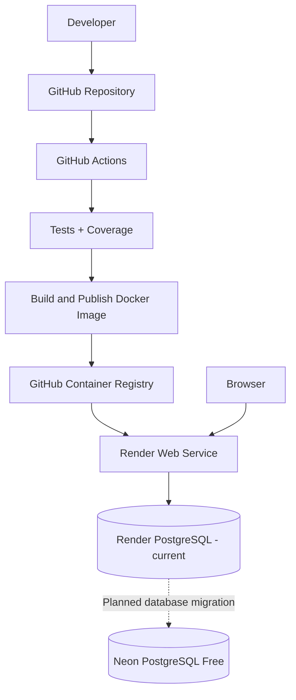

# DualTrack Enterprise

**A secure, multi-user job application management system built with Java, Spring Boot and PostgreSQL.**

DualTrack Enterprise is a full-stack application for managing job applications through their lifecycle. It provides authenticated user accounts, application management, server-side search and pagination, dashboard statistics, and an auditable history of application status changes.

The project is structured as a **layered Spring Boot application within a modular monolith**. It uses PostgreSQL for persistent storage, Flyway for database migrations, Spring Security for authentication and authorization, and Docker for reproducible local environments.

**Live demo:** https://dualtrack-enterprise.onrender.com

The frontend and REST API are served by the same Spring Boot application. The current deployment runs on Render and uses a managed PostgreSQL database.

---

## Table of Contents

- [Project Overview](#project-overview)
- [Core Features](#core-features)
- [Architecture](#architecture)
- [Application Request Flow](#application-request-flow)
- [Data Model](#data-model)
- [Security Design](#security-design)
- [Technology Stack](#technology-stack)
- [API Reference](#api-reference)
- [Database Management](#database-management)
- [Testing Strategy](#testing-strategy)
- [CI Pipeline](#ci-pipeline)
- [Docker and Local Development](#docker-and-local-development)
- [Project Structure](#project-structure)
- [Configuration](#configuration)
- [Deployment and Hosting](#deployment-and-hosting)
- [Engineering Decisions](#engineering-decisions)

---

## Project Overview

Managing multiple job applications involves more than storing company names and job titles. Applications move through different stages, information changes over time, and users need a reliable way to track progress.

DualTrack Enterprise addresses this problem through a multi-user application with a clear separation of responsibilities.

Each authenticated user can:

- Maintain their own collection of job applications.
- Record company, position, application date and notes.
- Update application details and status.
- Search and filter applications.
- Navigate results through server-side pagination.
- View statistics for different application statuses.
- Inspect the history of status changes.

The backend enforces application ownership. A user cannot access or modify another user's application simply by supplying its database ID.

### Application status lifecycle



The system supports four application statuses:

| Status | Meaning |
|---|---|
| `APPLIED` | Application submitted |
| `INTERVIEWING` | Interview process underway |
| `REJECTED` | Application rejected |
| `OFFERED` | An offer received |

Status updates are recorded separately from the current application record, preserving a history of changes.

---

## Core Features

### Authentication and account management

- User registration and login.
- Email normalization before account lookup and registration.
- BCrypt password hashing.
- Server-side HTTP session authentication.
- CSRF protection for state-changing requests.
- Logout with session invalidation.

### Application management

- Create, retrieve, update and delete applications.
- Input validation through Jakarta Bean Validation.
- Per-user data ownership enforcement.
- Optimistic locking through JPA's `@Version` field.
- Automatic creation and update timestamps.

### Dashboard and data retrieval

- Server-side pagination.
- Search by company name and position title.
- Combined search and status filtering.
- Dashboard statistics grouped by application status.
- Application status history.
- Consistent sorting by application date.

### Persistence and infrastructure

- PostgreSQL relational database.
- Flyway version-controlled schema migrations.
- Hibernate schema validation.
- Dockerized application and database.
- GitHub Actions continuous integration.
- JaCoCo code coverage reporting and enforcement.
- PostgreSQL integration tests using Testcontainers.

---

## Architecture

DualTrack Enterprise follows a layered architecture. Each layer has a defined responsibility, allowing business logic, HTTP handling and persistence to evolve independently.

### High-level system architecture



### Layer responsibilities

| Layer | Responsibility |
|---|---|
| Frontend | User interaction, form handling, dashboard rendering and API communication |
| Security | Authentication, session management, CSRF protection and access control |
| Controller | HTTP endpoints, request parameters, validation and response handling |
| Service | Business rules, ownership checks, transactions and status history |
| Repository | Database queries and persistence operations |
| Model | JPA entities representing users, applications and status history |
| Database | Persistent relational storage |
| Flyway | Versioned and repeatable database schema evolution |

### Backend request flow



The service layer is deliberately responsible for business rules rather than placing them in controllers or database repositories. This makes the application easier to test and keeps the persistence layer focused on data access.

---

## Application Request Flow

Consider a user creating a new application.

1. The browser sends a POST request to `/api/applications`.
2. Spring Security verifies the user's session and CSRF token.
3. `ApplicationController` receives the request and validates the payload.
4. `ApplicationService` resolves the authenticated user.
5. The service creates an application associated with that user.
6. The repository persists the application.
7. An initial status-history record is created.
8. The service returns an application DTO.
9. The controller responds with HTTP `201 Created`.



The application creation and initial history operation are performed within a transactional service method.

---

## Data Model

The database contains three main entities:

- `app_users`
- `applications`
- `application_status_history`

### Entity relationship diagram



### Entity responsibilities

**User**

Stores account information, including a unique email address and a BCrypt password hash.

**Application**

Stores the current state of a job application. Each application belongs to exactly one user through `user_id`.

The entity also contains:

- `created_at` and `updated_at` timestamps.
- An optimistic locking version field.
- Database indexes supporting owner-based date and status queries.

**StatusHistory**

Stores individual status transitions. Each entry references the application and the user responsible for the change.

When an application is created, an initial history record is generated. When its status changes, another record is inserted. Editing unrelated application fields does not create an unnecessary status-history entry.

### Why separate status history?

The application table represents the current state. The history table represents how that state evolved.

This separation avoids overwriting previous status information and makes it possible to inspect the application's progression over time.

---

## Security Design

Security is enforced primarily through Spring Security and service-level ownership checks.

### Authentication

The application uses server-side HTTP sessions rather than JWT-based authentication.

Registration and login are handled through dedicated authentication endpoints.

Passwords are encoded using BCrypt with a configured work factor of 12. Plain-text passwords are never stored in the database.

### Session management

After successful authentication:

1. Spring Security authenticates the submitted credentials.
2. The application establishes an authenticated security context.
3. The security context is stored in the HTTP session.
4. Subsequent requests are authenticated through the session cookie.

The session cookie is configured with:

- `HttpOnly`
- `SameSite=Lax`
- Configurable `Secure` flag

Production deployment must enable secure cookies over HTTPS.

### CSRF protection

The application uses Spring Security's `CookieCsrfTokenRepository`.

The frontend obtains a CSRF token from `/api/auth/csrf` and supplies it when making state-changing requests.

This is important because authentication is session-based: browsers automatically attach session cookies to applicable requests.

### User ownership enforcement

Application ownership is enforced at the service and repository layers.

For example, application lookup uses:

```java
apps.findByIdAndUserId(id, user.getId())
```

This means the application must match both:

- The requested application ID.
- The authenticated user's database ID.

A guessed application ID belonging to another user does not grant access. The service returns a not-found response instead.

This ownership check is applied to update, delete and history operations as well as normal retrieval.

### Security boundaries



---

## Technology Stack

| Area | Technology | Purpose |
|---|---|---|
| Language | Java 17 | Backend implementation |
| Framework | Spring Boot 3.4.5 | Application framework |
| API | Spring Web | REST endpoints |
| Security | Spring Security | Authentication and authorization |
| Validation | Jakarta Bean Validation | Request validation |
| Persistence | Spring Data JPA | Repository abstraction |
| ORM | Hibernate | Object-relational mapping |
| Database | PostgreSQL 16 | Relational data storage |
| Migration | Flyway | Versioned database migrations |
| Frontend | HTML, CSS, JavaScript | Browser interface |
| Build | Maven | Dependency management and build lifecycle |
| Testing | JUnit 5, Mockito | Unit and application tests |
| Integration testing | Testcontainers | Real PostgreSQL integration tests |
| Coverage | JaCoCo | Code coverage reporting and quality gate |
| Containerization | Docker, Docker Compose | Reproducible environments |
| CI | GitHub Actions | Automated verification |

---

## API Reference

All application endpoints require an authenticated session.

### Authentication endpoints

| Method | Endpoint | Description |
|---|---|---|
| `GET` | `/api/auth/csrf` | Obtain a CSRF token |
| `POST` | `/api/auth/register` | Register a user |
| `POST` | `/api/auth/login` | Authenticate and create a session |
| `POST` | `/api/auth/logout` | Invalidate the current session |
| `GET` | `/api/auth/me` | Retrieve the authenticated user |

### Application endpoints

| Method | Endpoint | Description |
|---|---|---|
| `GET` | `/api/applications` | Retrieve paginated applications |
| `POST` | `/api/applications` | Create an application |
| `PUT` | `/api/applications/{id}` | Update an application |
| `DELETE` | `/api/applications/{id}` | Delete an application |
| `GET` | `/api/applications/stats` | Retrieve dashboard statistics |
| `GET` | `/api/applications/{id}/history` | Retrieve status history |

### Search, filtering and pagination

The application listing endpoint supports combined search, status filtering and pagination.

Example:

```http
GET /api/applications?page=0&size=20&status=APPLIED&q=SAP
```

Parameters:

| Parameter | Description |
|---|---|
| `page` | Zero-based page number |
| `size` | Number of records per page; maximum 100 |
| `status` | Optional application status |
| `q` | Optional search term for company or position |

The endpoint returns a structured page response containing the records, page information, total element count and pagination flags.

### Example application creation

```http
POST /api/applications
Content-Type: application/json
```

```json
{
  "companyName": "SAP",
  "positionTitle": "Junior Java Developer",
  "status": "APPLIED",
  "applicationDate": "2026-11-22",
  "notes": "Application submitted through the company career portal."
}
```

The request is validated before the service layer processes it.

### Response conventions

| HTTP status | Meaning |
|---|---|
| `200 OK` | Successful retrieval, update or login |
| `201 Created` | Resource successfully created |
| `204 No Content` | Successful deletion or logout |
| `400 Bad Request` | Invalid request data |
| `401 Unauthorized` | Missing or invalid authentication |
| `404 Not Found` | Resource unavailable or not owned by the authenticated user |

Health monitoring is available through:

```http
GET /actuator/health
```

---

## Database Management

Flyway manages the database schema through versioned migration scripts.

The initial schema is defined in:

```text
backend/src/main/resources/db/migration/
    V1__create_users_applications_and_history.sql
```

When the application starts, Flyway applies pending migrations before the application uses the schema.

Hibernate is configured with:

```properties
spring.jpa.hibernate.ddl-auto=validate
```

This is intentional.

Flyway owns schema creation and modification. Hibernate checks whether the database schema matches the entity mappings rather than silently creating or changing tables.

This provides a more controlled database evolution process.

---

## Testing Strategy

The project uses different testing approaches for different levels of the application.

### 1. Unit tests with Mockito

Service-layer tests isolate business logic from the database.

Dependencies such as repositories, password encoders and authentication managers are mocked.

The tests cover:

- Application creation and owner assignment.
- Search term normalization.
- Pagination and filtering delegation.
- Status update and history creation.
- Avoiding history entries when status remains unchanged.
- Ownership enforcement.
- Application deletion.
- Dashboard statistics.
- Authentication email normalization.
- Duplicate registration handling.
- Password encoding.
- Authentication delegation.

### 2. PostgreSQL integration tests with Testcontainers

Unit tests cannot prove that application code works correctly with the actual database engine.

For that reason, the project includes PostgreSQL integration tests using Testcontainers.

The integration test starts a real PostgreSQL 16 container and configures the Spring application to connect to it.

It verifies:

- Flyway migration execution.
- Application persistence.
- Status updates.
- Status-history persistence.
- Database-backed filtering.
- Isolation between different users.

This tests the interaction between the service layer, JPA/Hibernate, Flyway and PostgreSQL rather than relying exclusively on mocks.

### Testing architecture



### Coverage enforcement

JaCoCo generates coverage reports during the Maven verification lifecycle.

The configured quality gate requires at least **70% line coverage** for:

```text
com.dhbw.tracker.service
```

This is a package-specific coverage requirement, not a claim that the entire application has 70% coverage.

The HTML report is generated at:

```text
backend/target/site/jacoco/index.html
```

The CSV report is generated at:

```text
backend/target/site/jacoco/jacoco.csv
```

The latest local verification recorded 15 passing tests and 100% line coverage across the measured service package (74 of 74 lines). The enforced threshold remains 70%.

---

## CI Pipeline

GitHub Actions automatically verifies changes pushed to `main` or `develop`, and pull requests targeting `main`.

Workflow:

```text
.github/workflows/ci.yml
```

### Current CI workflow



The workflow currently performs:

1. Repository checkout.
2. Java 17 environment setup.
3. Maven dependency caching.
4. Docker Buildx setup.
5. Unit and integration test execution.
6. JaCoCo coverage enforcement.
7. Production Docker image build.
8. JaCoCo report upload as a GitHub Actions artifact.

On pushes to `main`, the workflow authenticates to GitHub Container Registry and publishes the production image as `ghcr.io/nestorniloy/dualtrack-enterprise` with `latest` and commit-SHA tags. Pull requests and other branch builds verify the image without publishing it.

The JaCoCo report artifact is retained for 14 days.

---

## Docker and Local Development

The application and PostgreSQL database can be started together using Docker Compose.

### Prerequisites

- Java 17 or newer.
- Maven 3.9 or newer.
- Docker Desktop.
- Git.

### Start the application

Clone the repository:

```bash
git clone https://github.com/nestorNiloy/dualtrack-enterprise.git
cd dualtrack-enterprise
```

Start the services:

```bash
cd backend
docker compose up --build
```

Open:

```text
http://localhost:8080
```

Docker Compose starts:

- A PostgreSQL 16 database.
- The Spring Boot application.
- A persistent named volume for PostgreSQL data.

The application waits for the database health check before starting.

### Stop the application

```bash
docker compose down
```

The named database volume is preserved.

To remove the containers and local database volume:

```bash
docker compose down -v
```

**Note:** The credentials in the supplied Compose file are development-only values. They must be replaced with secure environment-specific credentials for deployment.

### Run tests locally

From the `backend` directory:

```bash
mvn clean verify
```

This runs the Maven verification lifecycle, including the configured unit tests, PostgreSQL integration tests and coverage gate.

### Build and run without Docker Compose

Start a PostgreSQL 16 database separately, configure the database environment variables, and run:

```bash
mvn clean verify
mvn spring-boot:run
```

---

## Project Structure

```text
dualtrack-enterprise/
│
├── .github/
│   └── workflows/
│       └── ci.yml
│
├── backend/
│   ├── src/
│   │   ├── main/
│   │   │   ├── java/com/dhbw/tracker/
│   │   │   │   ├── config/
│   │   │   │   │   └── SecurityConfig.java
│   │   │   │   ├── controller/
│   │   │   │   │   ├── ApplicationController.java
│   │   │   │   │   └── AuthController.java
│   │   │   │   ├── dto/
│   │   │   │   ├── exception/
│   │   │   │   ├── model/
│   │   │   │   ├── repository/
│   │   │   │   ├── service/
│   │   │   │   └── ApplicationTrackerApplication.java
│   │   │   │
│   │   │   └── resources/
│   │   │       ├── db/migration/
│   │   │       ├── static/
│   │   │       │   ├── js/
│   │   │       │   └── index.html
│   │   │       └── application.properties
│   │   │
│   │   └── test/
│   │       ├── java/com/dhbw/tracker/
│   │       │   ├── integration/
│   │       │   └── service/
│   │       └── resources/
│   │
│   ├── Dockerfile
│   ├── compose.yaml
│   └── pom.xml
│
├── README.md
└── START_HERE.md
```

### Package organization

The Java code is organized by responsibility:

- `config`: application and security configuration.
- `controller`: REST API endpoints.
- `dto`: request and response objects.
- `exception`: application-specific exception handling.
- `model`: JPA entities and application status definitions.
- `repository`: database access abstractions.
- `service`: business logic and transactional operations.

The frontend is served from Spring Boot's static resource directory, keeping the browser application and API on the same origin.

---

## Configuration

The application supports environment-based database and server configuration.

| Variable | Purpose | Local default |
|---|---|---|
| `PORT` | HTTP server port | `8080` |
| `DATABASE_URL` | JDBC database URL | `jdbc:postgresql://localhost:5432/dualtrack` |
| `DATABASE_USERNAME` | Database username | `dualtrack` |
| `DATABASE_PASSWORD` | Database password | `dualtrack` |
| `COOKIE_SECURE` | Secure session-cookie flag | `false` |

Example production configuration:

```text
DATABASE_URL=jdbc:postgresql://<database-host>:5432/<database-name>
DATABASE_USERNAME=<database-user>
DATABASE_PASSWORD=<database-password>
COOKIE_SECURE=true
```

Production credentials must be stored in the hosting provider's secret/environment configuration, never committed to Git.

---

## Deployment and Hosting

DualTrack Enterprise is deployed and publicly accessible:

**Live application:** https://dualtrack-enterprise.onrender.com

The deployed application uses the same Spring Boot service for the static frontend and REST API, with a managed PostgreSQL database for persistent application data.

### Current deployment status

| Component | Status |
|---|---|
| Spring Boot application on Render | Deployed |
| Public application URL | Live |
| Managed PostgreSQL database on Render | Connected |
| Docker image published to GitHub Container Registry | Implemented |
| GitHub Actions tests, coverage and image publishing | Implemented |
| Automatic deployment from GitHub Actions to Render | Not configured; Render deployment is managed separately |
| Migration of the production database to Neon Free | Planned |

The current Render free PostgreSQL database is time-limited. It should not be treated as permanent storage: after its free database period expires, the application will lose database connectivity until the database is upgraded or migrated. The planned migration to Neon is intended to keep the portfolio deployment on a $0 database plan, subject to Neon's free-tier quotas and terms.

### Deployment architecture



The production application is a single Spring Boot web service backed by PostgreSQL. The frontend and REST API remain on the same origin, preserving the existing session-based authentication and CSRF design.

Render's free web service may spin down after a period of inactivity, so the first request after an idle period can take longer while the service starts. This is separate from the database's expiration policy.

### Database portability

The application uses standard PostgreSQL connectivity through environment variables. The production database can be moved without changing the application architecture or rewriting the CRUD, authentication or dashboard features. The deployment configuration needs the destination PostgreSQL JDBC URL, username and password, and the existing Flyway migrations create and validate the schema on startup.

Neon Free is the planned destination because it provides a $0/month PostgreSQL tier with usage limits rather than the current Render database's 30-day free period. Its quotas and terms can change; see [Neon's plans documentation](https://neon.com/docs/introduction/plans) for current limits.
---

## Engineering Decisions

### 1. Modular monolith instead of microservices

The application currently has a relatively focused domain: user accounts, job applications and status history.

A modular monolith provides clear internal boundaries without introducing the operational overhead of multiple services, network communication, distributed transactions and service discovery.

The application can be developed, tested and deployed as one unit.

### 2. Session-based authentication instead of JWT

The browser application and backend are served from the same origin.

Server-side sessions provide a straightforward authentication model for this architecture. Spring Security manages authentication state, and CSRF protection addresses the risks associated with browser-attached session cookies.

JWT authentication would introduce additional token lifecycle and storage decisions without a clear benefit for the current system.

### 3. Flyway instead of automatic schema generation

Database changes should be explicit and version-controlled.

Flyway migrations make schema evolution predictable across development, testing and deployment environments. Hibernate validation helps detect differences between the entity mappings and the database schema.

### 4. DTOs instead of exposing JPA entities

Controllers communicate through request and response DTOs.

This separates the external API contract from the internal persistence model, allowing entity relationships and database implementation details to change without automatically changing API responses.

### 5. PostgreSQL integration tests instead of relying only on H2

H2 is useful for lightweight tests, but it does not behave identically to PostgreSQL in every situation.

Testcontainers allows integration tests to run against the actual database engine, improving confidence in migrations, SQL behavior and persistence integration.

### 6. Server-side filtering and pagination

Filtering and pagination are performed in the database rather than loading every application into the browser.

This reduces unnecessary data transfer and keeps query behavior consistent as the number of applications grows.

---

## Project Status

DualTrack Enterprise is an actively developed portfolio project focused on demonstrating practical backend engineering, relational data modeling, application security, automated testing and CI/CD practices.

The current implementation includes:

- Multi-user authentication.
- Ownership-aware application CRUD.
- Dashboard statistics and search.
- Application status history.
- PostgreSQL persistence and Flyway migrations.
- Docker-based local execution.
- Automated unit and integration testing.
- Coverage enforcement.
- GitHub Actions CI and Docker build verification.

The next infrastructure milestone is migrating the production PostgreSQL database from Render to Neon Free. The live Render web service and existing application functionality will remain in place.

---

**Repository:** https://github.com/nestorNiloy/dualtrack-enterprise  
**Primary branch:** `main`  
**Backend:** Java 17 / Spring Boot 3.4.5  
**Database:** PostgreSQL 16  
**Architecture:** Layered modular monolith
